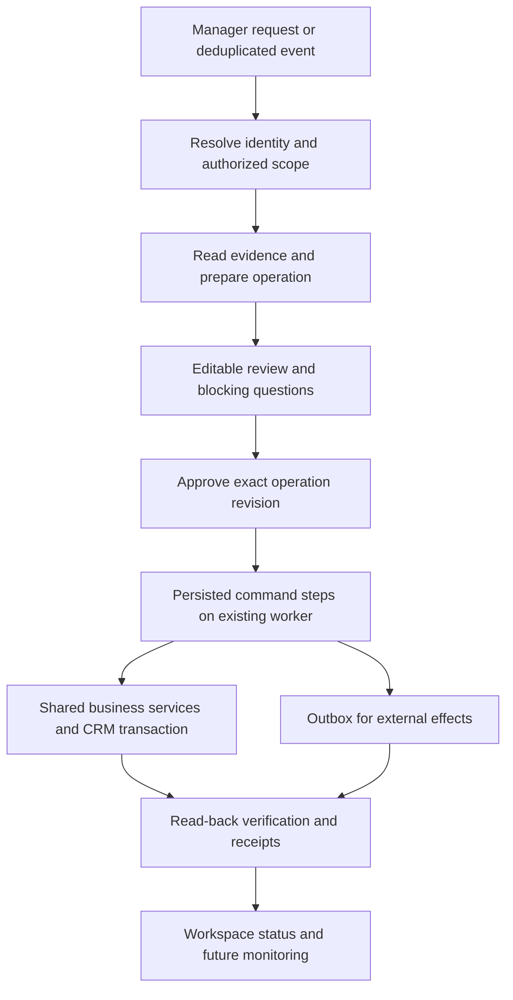

# Captain AI enhancement review

Date: 3 November 2026. Scope: architecture, business actions, tool use, UX, components, motion, and delivery priorities.

## Recommendation

Make Captain the operational workspace where a manager can prepare, review, execute, and track client work. Start with one complete journey: **turn a closing call or brief into a client ready for launch**. Then extend the same operation model to existing-client changes and mission recovery.

The highest-value investment is connecting intelligence to reliable business commands and an editable execution surface. The current code already provides much of the agent infrastructure. A rewrite or a new agent framework is not the first step.

## Evidence and limits

This review examined the current working tree, including uncommitted Captain changes. It does not assume those changes are deployed. Existing screenshots were inspected for visual direction; they are not a live browser inspection and some client-screen copy differs from current source. No production data or live connector health was checked.

The earlier `CAPTAIN_AI_PRODUCT_ARCHITECTURE.md` already establishes the right direction. This review makes the implementation sequence, tool gaps, and experience contracts more concrete. That earlier document and all existing application changes were preserved.

Executed locally, all passing: `test:assistant-ui` (98), `test:agent-playbooks` (36), `test:assistant` (103). These are logic/runtime tests, not proof of production reliability, end-to-end onboarding, or current visual accessibility.

## What exists today

| Area | Observed implementation | Implication |
|---|---|---|
| Workspace | `components/assistant-ui/workspace/AssistantWorkspace.tsx`: agency/client folders, URL state, persistent streaming hook, command palette, mobile rail | Keep this shell and extend it |
| Manager priorities | `folder/ManagerWork.tsx` and `manager-work.ts`: pending approvals, failures, findings, ongoing work; first three displayed | Good base for a decision inbox; coverage depends on available runs and rules |
| Client context | `folder/ContextPanel.tsx`: live profile, objectives, monthly activity, memory, files, pins | Context is readable; editing business records still generally leaves the Captain surface |
| Launch entry | `ManagerWork.tsx` opens the existing `ClientOnboardingWizard` | In-Captain access exists, but this is not a conversation-driven launch operation |
| Data access | `lib/ai/tools/registry.ts`, `definitions/crm.ts`: broad CRM read surface with project binding | Reading a mission is already easier than changing it |
| Actions | Tasks, drafts, documents, memory, credentials, portal accounts, onboarding email, report publishing | Core client/mission/campaign/planning mutations are missing from the assistant registry |
| Authorization | `guard.ts`, server Zod validation, tool roles/permissions/allowlists and write budgets | Preserve the server guard as the mandatory boundary |
| Confirmation | `assistant/execute/route.ts`, `agent/proposals.ts`: stored arguments, atomic claim, expiry, reauthorization | Good protection against duplicate clicks; extend this to versioned business-change previews |
| Agent runtime | `lib/ai/agent/runtime.ts`: streaming, evidence, verification, bounded retries, fallback, budgets | Reuse; number/source verification does not by itself verify a business operation completed |
| Background work | `lib/agent/queue.ts`, `mission.ts`, `phase.ts`: durable run queue, dedupe keys, worker claim/heartbeat, saved plan/checkpoint, completed-step resume | Persistence already exists at run/plan level; extend reliability down to individual commands and external effects |
| Proactivity | `playbooks/registry.ts`: client risk, SDR pace, weekly report, morning digest, delegated work | Useful start, not complete operational monitoring |
| Shared business logic | `app/api/clients/route.ts` creates client/mission/campaign assets transactionally; onboarding helpers and checklist service exist | Extract reusable commands from existing paths instead of duplicating them in tools |

## The first complete experience

Manager: “Prepare the launch from this closing call. Start next month with two SDRs.”

1. Resolve the company and relevant call. Offer possible matches if ambiguous. Do not create another company because its spelling differs.
2. Read the transcript/brief; build a field-level brief with source links. Label facts, manager decisions, and proposed assumptions separately. Never infer agreement on pricing, dates, or targets from a generic recommendation.
3. Prepare a launch operation: client information, contacts, mission objectives, targeting, scripts, campaign assets, onboarding checklist, proposed team and schedule.
4. Ask only questions that block the next meaningful step. Present them as small editable fields; retain the conversation for explanation and refinement.
5. Validate dates, SDR availability/assignment, exclusions, required assets, and integration readiness using deterministic business logic.
6. Display an editable review canvas: exact creations/updates, owners, dates, dependencies, recipients, and blockers. Show what is ready independently from what is blocked.
7. Apply selected valid steps after approval. Prevent selection of dependent steps whose prerequisites are not selected or completed. Keep email sending separate from internal record creation.
8. Verify resulting records and scheduling constraints. Present a receipt with links to each created object and an accurate partial-success state.
9. Continue tracking readiness and first activity after the chat closes. Notify the manager only when a decision, meaningful change, or failure needs attention.

For an already-created client, the same journey begins with a readiness assessment and missing setup. It must not recreate the client.

## Architecture to add

**Separate four concepts:** conversation (discussion), operation (business outcome), run (execution attempt), and command receipt (what actually changed). Existing `AgentRun`/`AgentStep` describe agent execution phases; they should not have to double as the full business record of a client launch.

Suggested additive records, with final naming decided during schema design:

- `CaptainOperation`: kind, goal, actor/authorized scope, client/mission/folder references when known, source event, revision, state, owner, dates. Before client creation, scope is the authorized agency context; bind returned IDs after creation.
- `CaptainOperationStep`: stable step key, command/version, dependencies, validated input, preconditions, status, result references, error and retry classification. Distinguish blocked, awaiting approval, executing, partially completed, verified, failed, and cancelled at the appropriate aggregate level.
- `CaptainApproval`: exact selected steps, input revision/hash, approver, recipients, relevant precondition versions, expiry. Editing a preview invalidates the affected approval.
- `CaptainCommandReceipt`: unique command idempotency key, request fingerprint, status, returned CRM IDs, verification outcome. The same key with a different payload is rejected.
- `CaptainOutboxEvent`: external action, destination, operation/step reference, stable dedupe key, attempts, next retry, provider receipt, reconciliation state.

Do not add another queue initially. Use the existing Postgres run queue/worker to execute operation steps. Keep run budgets and cancellation. A larger workflow platform is a later decision if operational scale and recovery complexity justify it.

Reliability contracts:

- Persist internal business changes and their command receipt in the same database transaction where possible.
- Keep the command idempotency key stable across worker retries and replacement runs; a transient run ID alone is insufficient.
- Handle “provider succeeded but response/worker was lost” as an uncertain outcome. Reconcile using provider IDs/idempotency support before retrying. An outbox alone does not guarantee exactly-once delivery.
- Approval claim is not an execution receipt. A worker crash after an action is claimed needs recovery and reconciliation, not blind repeat execution.
- Check permissions, client/mission ownership and record versions again when executing. A TTL does not detect another manager changing a mission moments after the preview.
- Define cancellation at command boundaries and state what already happened. Never offer “undo” for an email already delivered. Use compensating actions only where the business supports them.
- Aggregate operation status from actual step outcomes. “No pending approval” does not necessarily mean every requested change succeeded; existing proposal settling deserves a separate outcome-semantic review before reuse for operations.
- Add a versioned event stream for workspace updates, with reconnect cursor/snapshot reconciliation and polling fallback. Existing 30-second polling can remain during the first slice.

Retry/idempotency design is consistent with the [AWS durable execution guidance](https://docs.aws.amazon.com/durable-execution/patterns/best-practices/idempotency/); this is a design reference, not a recommendation to migrate hosting.

## Tool use: expand business capability deliberately

Expose a small coherent command surface, backed by the same services used by CRM pages. Suggested tool names below are proposals, not existing tools.

| Capability | Proposed tools | Execution policy |
|---|---|---|
| Resolve launch | `resolve_client_identity`, `get_launch_readiness` | Read only; return ambiguity and source freshness |
| Prepare outcome | `prepare_client_launch`, `revise_operation`, `validate_operation` | Persist private drafts; no operational record changes |
| Client profile | `prepare_client_update` | Produce field diff and versions; approval for business changes |
| Mission lifecycle | `prepare_mission_create`, `prepare_mission_update`, `prepare_mission_status_change` | Validate permitted status transitions, dates, objectives, and scope |
| Campaign preparation | `prepare_campaign_assets` | Draft targeting/scripts; show activation separately |
| Team and planning | `get_team_capacity`, `simulate_schedule`, `prepare_assignment_changes` | Deterministic capacity/conflict checks; approval for allocations |
| Apply and recover | `apply_operation`, `get_operation_status`, `retry_operation_step`, `cancel_operation` | Apply only stored approved revisions; do not accept arbitrary model-built writes |
| Communications | Reuse current draft/send tools, connect them to operation steps | Preview exact message and recipients before sending |

Prefer task-oriented preparation tools over forcing the model through dozens of individual field setters. Still execute the resulting operation through small, testable business commands. Avoid a general `update_record` tool or write-enabled SQL.

Tool engineering improvements:

1. Extend tool metadata with input/output schema versions, effects, scope, preview support, idempotency policy, expected latency, and retry classification.
2. Return structured errors such as `ambiguous_client`, `stale_revision`, `capacity_conflict`, `connector_unavailable`, and `outcome_unknown`, with a safe next action.
3. Build tool discovery from current operation type and active scope as well as user wording. Current `profiles.ts` relies mainly on French keyword triggers; retain its `load_tool_group` escape hatch and add multilingual/follow-up routing evaluations.
4. Consider strict argument schemas for the new mutation tools first. The current Responses adapter uses `strict: false`, and schema slimming removes constraints: simply changing that flag globally would be incompatible with that approach. Add provider-aware schema compilation while retaining server validation. [OpenAI function-calling documentation](https://developers.openai.com/api/docs/guides/function-calling) describes strict-mode schema requirements.
5. Parallelize independent reads within budgets; serialize dependent writes. Refresh/invalidate relevant client, mission, planning and operation caches after each successful command, not only agent lists.
6. Propagate one operation ID through model turns, tool traces, business commands, outbox records and receipts. Track cost and latency per completed business outcome.
7. Keep existing scoped retrieval, evidence, and summaries. Add field provenance and conflict resolution for extracted briefs. CRM records remain authoritative; conversational memory must not silently override them.
8. Connector availability and permission checks should govern which actions are offered. A disconnected calendar is “planning not verified,” not “no conflicts.” Validate imported web URLs and treat retrieved material as data, never tool instructions.

## UX and component direction

Keep the white/navy/magenta visual system, readable typography, client rail, and existing shadcn/Radix primitives. Make the interface denser when work exists; preserve a calm first-use state.

**Agency home:** decisions first, then blockers, then active work. Each priority should show client, affected mission, business consequence, evidence age, owner, and one concrete next step. Keep three highlighted priorities and a clear total/inbox link. Use due date and operational impact to break ties in the current fixed priority ordering.

**Client workspace:** a compact sticky client/mission scope bar, launch readiness, open decisions, active operations, and current performance. Replace static starter prompts with actions generated from actual readiness and available capabilities. Offer profile and mission edits inline, without sending the manager back to a different CRM screen for routine changes.

**Active operation:** conversation beside an editable review canvas on wide screens. The canvas shows structured business objects; the conversation explains or revises them. On mobile, switch between “Discussion” and “Plan” with a sticky decision summary. Avoid multiple nested sheets for one task.

**Context panel:** keep it for evidence, files and detailed context. Put essential scope, blockers and operation state in the primary surface. Managers should not need to open “Mémoire et contexte” to know which mission a change affects.

**Unified work presentation:** reduce the conceptual distinction between “Captain AI” and “Agent.” A manager asks, reviews, and follows work in the same workspace. Keep advanced automation configuration accessible through secondary settings.

| Component | Purpose | Existing starting point |
|---|---|---|
| `ScopeBar` | Always-visible client/mission, operation state, freshness | `ThreadHeader`, `FolderHome` |
| `DecisionInbox` / `DecisionCard` | Evidence, consequence, due date, owner, next step | `ManagerWork`, agent `Inbox` |
| `LaunchReadiness` | Required assets, actual blockers, missing source checks | Context overview and checklist service |
| `OperationCanvas` | Structured editable launch/change plan | New surface beside `Thread`; reuse form primitives |
| `ChangeSetPreview` / `FieldDiff` | Before/after values, source and manager correction | Extend `ActionConfirmationCard`; use action-specific icons instead of its universal key icon |
| `BlockingQuestions` | Minimal required inputs, preserving work | Existing onboarding schemas/form fields |
| `OperationTimeline` | Dependencies and business-step progress | `RunsTimeline`, `RunDetail`; retain technical trace as expandable detail |
| `ExecutionReceipt` | Created/updated links, verification, partial success, recovery | Existing action outcomes and proposal cards |
| `ConnectorHealth` | Availability, permissions, last successful sync | Integration state exposed through authorized reads |

Component contracts should consume a server-validated discriminated schema. Model output selects supported cards and supplies data; it must not inject arbitrary UI code. Preserve keyboard navigation, focus restoration, screen-reader status announcements, error recovery, and draft retention.

## Motion and responsiveness

Motion should communicate a real state transition. Existing design tokens, transition utilities, and reduced-motion rules provide a starting point; confirm coverage for each new component rather than claiming it is absent today.

- Opening a plan: 180–240 ms opacity/short translation; preserve focus and avoid layout jumps.
- Applying changes: highlight the affected field/step, then show a verified receipt. Success appears only after server confirmation.
- Long work: live named steps and elapsed time. Show completed/total steps only when the total is known; do not invent a percentage from model activity.
- New decisions: one restrained entrance/highlight without reordering the item under the pointer or stealing focus.
- Streaming: maintain scroll position when the manager reads older content; show a “new activity” affordance. Avoid repeatedly animating the entire answer.
- Respect reduced motion with static state changes and text. The [W3C animation guidance](https://www.w3.org/WAI/WCAG21/Understanding/animation-from-interactions) supports disabling nonessential interaction animation.
- Reuse CSS transitions initially; add an animation library only for a demonstrated layout/choreography need. Load expensive operation surfaces on demand, following the current dynamic-import pattern.

## Proactivity that creates useful work

Start with high-signal events and readiness rules, not generic recommendations:

1. `client.created`: prepare the missing-setup/readiness operation for the existing client.
2. Closing call available: suggest a launch draft after company/call matching and manager confirmation of intent. Availability of a transcript does not prove the deal was won.
3. Start date approaching: detect missing approved brief, SDR coverage, campaign assets, access, or prospect stock.
4. Mission pace deviates: compare actual work, plan, list stock and outcomes before proposing a corrective action. Current risk/pace rules are inputs to extend.
5. Approved changes applied: check first activity and surface blockers or the weekly review at the appropriate time.

Use authenticated integration ingestion, durable event storage and a transactional outbox where events originate in the CRM. Deduplicate on source event and workflow type, filter out imports/backfills as appropriate, and record the event's authorized actor/service principal. A user disabled after scheduling must not retain execution rights through a stale job.

Deduplicate and suppress unchanged alerts. Allow snooze, owner assignment and dismissal reasons. Use dismissed/accepted outcomes to tune rules; do not claim an uncalibrated numerical “confidence score.”

## Delivery order and acceptance criteria

These are implementation slices, not time estimates. Actual estimates need service-boundary and deployment review.

| Order | Deliverable | Exit criterion |
|---|---|---|
| 1 | Shared launch command, operation/revision/receipt model, worker integration | Existing UI and Captain use the same business validation; duplicate/retried execution returns the same created records |
| 2 | Closing brief → editable launch review → apply → receipt | Manager completes the agreed launch scope inside Captain; closing/reopening the chat preserves progress and results |
| 3 | Client details, mission changes, assignment/planning simulation | Inline diff and conflict resolution; competing manager changes invalidate affected approvals |
| 4 | New-client/readiness triggers and unified decision inbox | Event redelivery creates one operation; missing connectors are visible; unchanged alerts remain quiet |
| 5 | Reconnectable progress events, refined motion, wider playbooks | Reconnect reconstructs accurate state; keyboard/mobile/reduced-motion checks pass |

First slice scope: client + mission + campaign draft/assets + onboarding checklist, with exact supported fields chosen from the existing wizard. Add capacity planning and external sends as subsequent operation steps once their command and recovery contracts are ready. Do not advertise a complete automatic launch until those dependencies are implemented.

Required scenario checks before enabling writes:

- Ambiguous company, existing company, and similar name in another authorized scope.
- Another manager changes a reviewed mission or schedule before execution.
- Double approval, duplicate event, worker crash before/after database commit, and resume.
- External send succeeds but response is lost; reconcile before any resend.
- Approval/permission expires or access is revoked while work is waiting.
- Partial success, step retry, cancellation after an irreversible effect, and unavailable connector.
- Transcript/web prompt injection, unsupported assumptions and unverified commitments.
- Mobile review, keyboard-only approval, screen-reader status, reduced motion, stream reconnect, preserved drafts.

Extend current tests and eval scenarios rather than creating another harness. Add operation-level integration tests with synthetic CRM data and stubbed connectors; run a controlled manager pilot before broader autonomy.

Measure: manager active time to a launch-ready client, completion without help, corrections/re-entry, approved recommendations that reach verified completion, recovery success, duplicate effects, stale-approval conflicts, tool/connector failure rate, latency and cost per successful operation. Establish a baseline before setting numerical improvement targets.

## Decision to make first

Approve the product direction **“prepare and launch a client entirely inside Captain, with an editable plan and persistent execution receipts.”** It gives architecture, tools, components, and animations one concrete journey to serve. Once that journey is reliable, apply the same model to controlling existing missions and ongoing client work.
